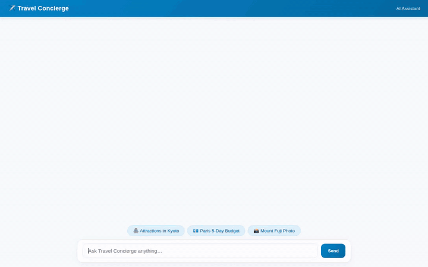

# Travel Concierge Agent



An intelligent, multi-modal AI travel assistant built with the **Google Agent Development Kit (ADK)** and powered by **Gemini** models on Vertex AI. The Travel Concierge helps travelers plan personalized vacations, explore cultural heritage sites, estimate itemized trip budgets, check live destination weather, locate nearby attractions via Google Maps APIs, and generate rich destination images and short video highlights.

---

## 🌟 Wired Google Cloud & AI Capabilities

This project implements the following Google Cloud services, models, and ADK components:

- **Google Agent Development Kit (ADK)**: Core agent framework utilizing `gemini-2.5-flash` on Vertex AI (`us-east1`) for natural conversation and tool orchestration.
- **Vertex AI Memory Bank**: Durable cross-session long-term memory integration (`PreloadMemoryTool` and `VertexAiMemoryBankService`). Automatically remembers traveler preferences, dietary restrictions, and food allergies across past conversations to personalize recommendations.
- **Google Cloud Firestore**: Persistent NoSQL database for managing destination catalogs (`search_destinations` and `add_destination`).
- **Vertex AI Image Generation**: Text-to-image generation via `gemini-3.1-flash-lite-image` in the `global` region for creating scenic destination photos.
- **Vertex AI Video Generation**: Text-to-video generation using Google's `gemini-omni-flash-preview` model in the `global` region for generating short travel video highlights.
- **Google Cloud Storage (GCS)**: Public bucket storage for hosting generated image and video assets with accessible HTTPS URLs.
- **Agent Engine Sandbox Code Executor**: Secure Python execution sandbox (`AgentEngineSandboxCodeExecutor`) for performing budget calculations and data processing.
- **A2UI (Agent-to-User Interface)**: Structured UI payload callback (`a2ui_callback`) emitting standardized JSON component trees (Cards, Columns, Rows, Text, Images) for custom frontend rendering.
- **Location & Environmental APIs**:
  - **Google Maps Geocoding API**: Address to coordinate resolution (`geocode_address`).
  - **Google Places API (New)**: Nearby point of interest lookup (`find_nearby_places`).
  - **Open-Meteo Weather API**: Real-time temperature, humidity, and wind forecasts (`get_live_destination_weather`).

---

## 🏗️ Project Architecture

```
travel-concierge-agent/
├── app/
│   ├── agent.py               # Root ADK agent definition, tools, and callbacks
│   └── a2ui_utils.py          # A2UI payload formatters and callbacks
├── frontend/
│   ├── main.py                # FastAPI proxy server (A2A protocol bridge)
│   ├── index.html             # Single-page Web UI with built-in A2UI renderer
│   └── requirements.txt       # Frontend dependencies
├── agents-cli-manifest.yaml   # Agent Platform project manifest
├── deployment_metadata.json   # Deployment tracking metadata
├── demo.gif                   # Looping demonstration recording
└── README.md                  # Project documentation
```

---

## 🚀 Local Setup & Running Instructions

### Prerequisites
- Python 3.11+
- Google Cloud SDK (`gcloud`) with active GCP authentication
- Configured GCP Project with Vertex AI, Firestore, and Cloud Storage APIs enabled

### 1. Authentication & Environment Setup
Authenticate your local environment with Google Cloud credentials:

```bash
gcloud auth login
gcloud auth application-default login
```

Create a `.env` file in the root directory with your environment configuration:

```env
GCP_PROJECT_ID=your-gcp-project-id
GOOGLE_CLOUD_PROJECT=your-gcp-project-id
GOOGLE_MAPS_API_KEY=your-google-maps-api-key
```

### 2. Running the Agent Backend
Install dependencies and run the ADK Agent locally:

```bash
# Using uv (recommended)
uv run python -m app.agent

# Or using standard pip / virtualenv
pip install -r requirements.txt
python -m app.agent
```

### 3. Running the Custom Web Frontend
Start the FastAPI proxy server and single-page web UI:

```bash
cd frontend
pip install -r requirements.txt

# Set deployment environment variables
export AGENT_ENGINE_RESOURCE_NAME="projects/<PROJECT_ID>/locations/us-east1/reasoningEngines/<ENGINE_ID>"
export AGENT_DIRECTORY="app"
export PORT=8080

python main.py
```

Once running, open your browser and navigate to port `8080` on your machine to interact with the Travel Concierge frontend.
